

  

<h1 align="center">SiliconShaders</h1>

  A native Apple Metal renderer with built-in shaders for Minecraft: Java Edition on Apple Silicon Macs.

  
  
  
  

  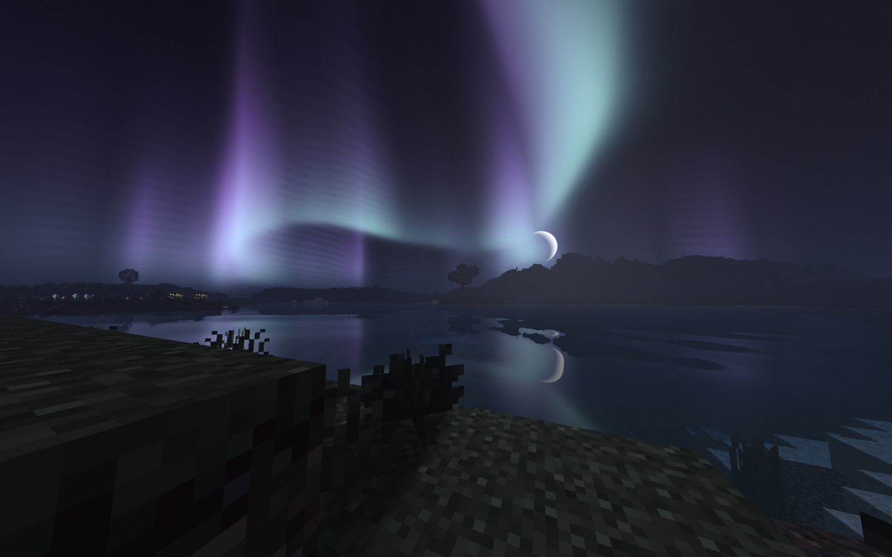

SiliconShaders replaces Minecraft's renderer with one written for Metal, then adds shader effects on top: shadows,
water, weather, sky and camera effects. It is not a shader pack and does not need Iris.

SiliconShaders is based on [mcopt](https://github.com/noahdunnagan/mcopt) by Noah Dunnagan.

> [!NOTE]
> **Coming soon: ray tracing.** An upcoming update adds ray-traced lighting for Macs with an **M3 chip or newer**,
> using the hardware ray tracing built into these chips. M1 and M2 Macs keep the current renderer.

## Screenshots

<table>
  <tr>
    <td>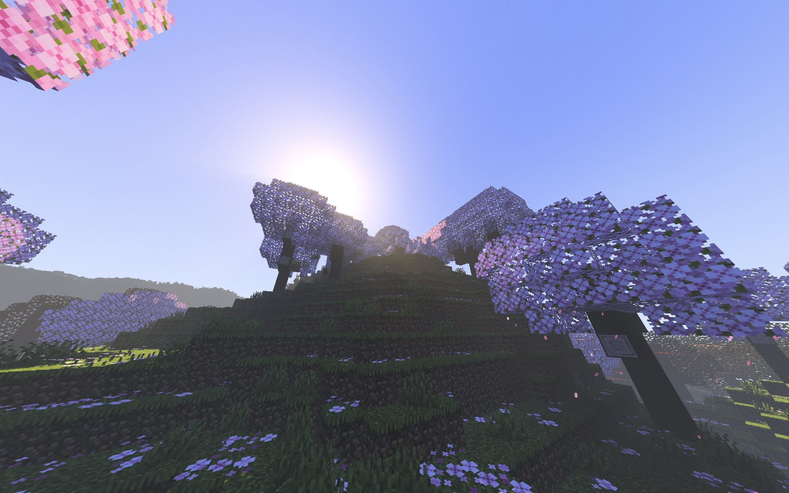</td>
    <td>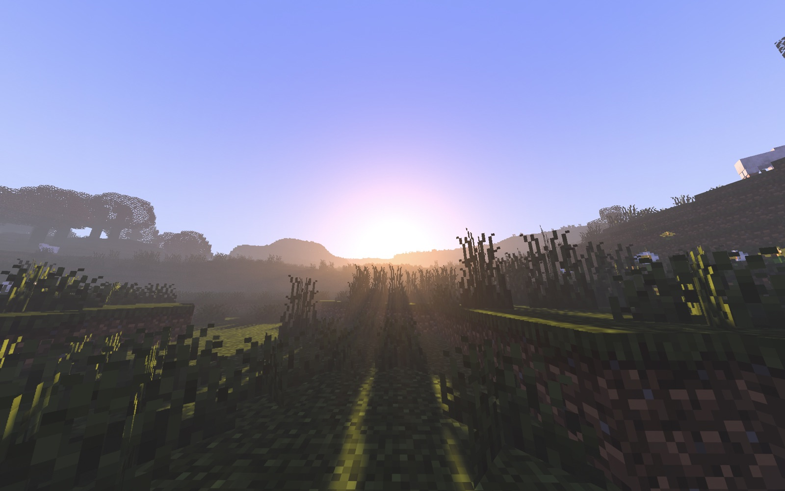</td>
  </tr>
  <tr>
    <td>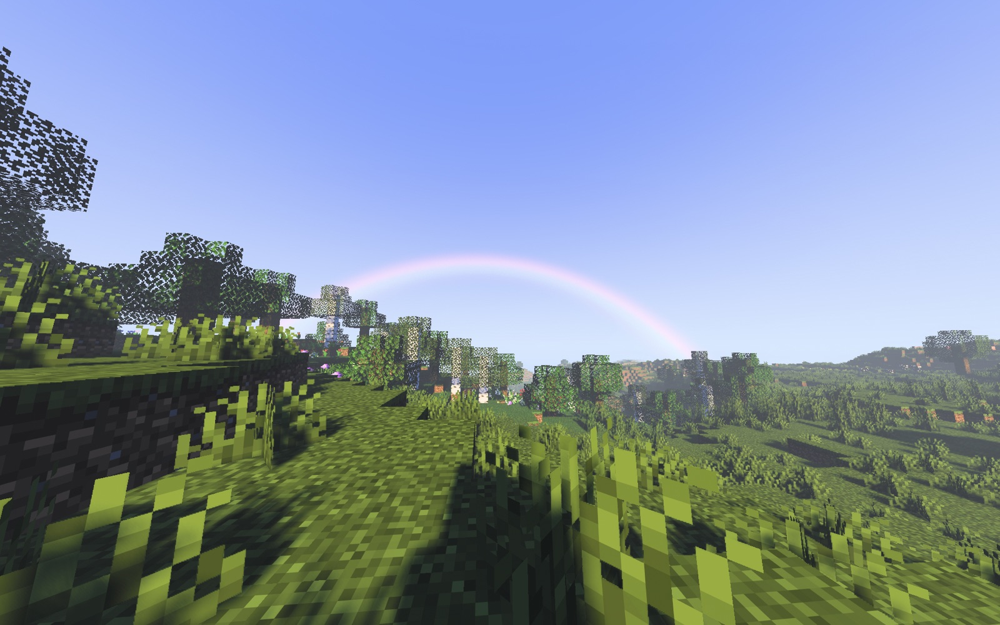</td>
    <td>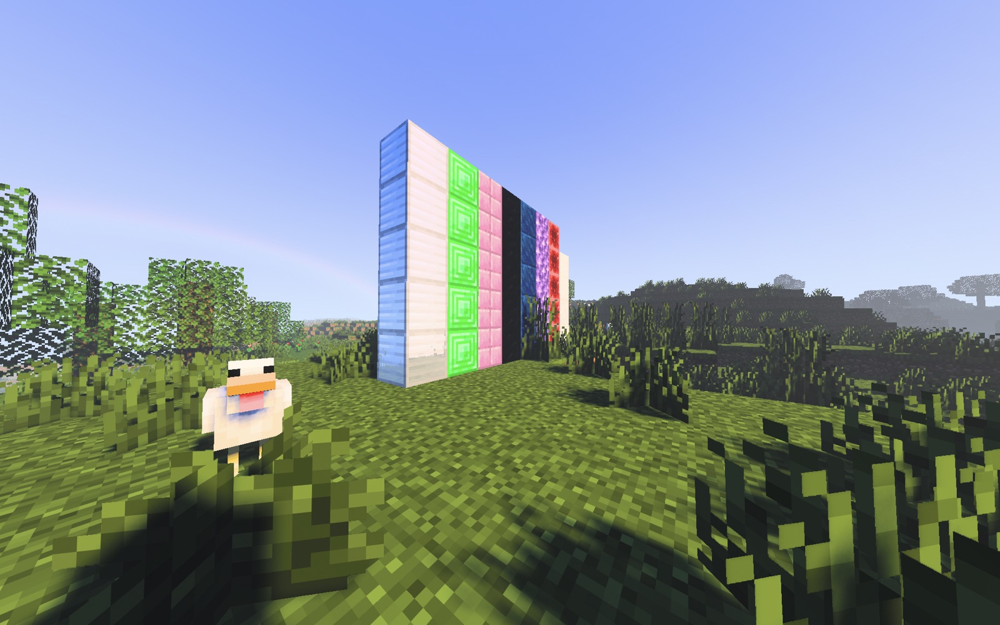</td>
  </tr>
  <tr>
    <td>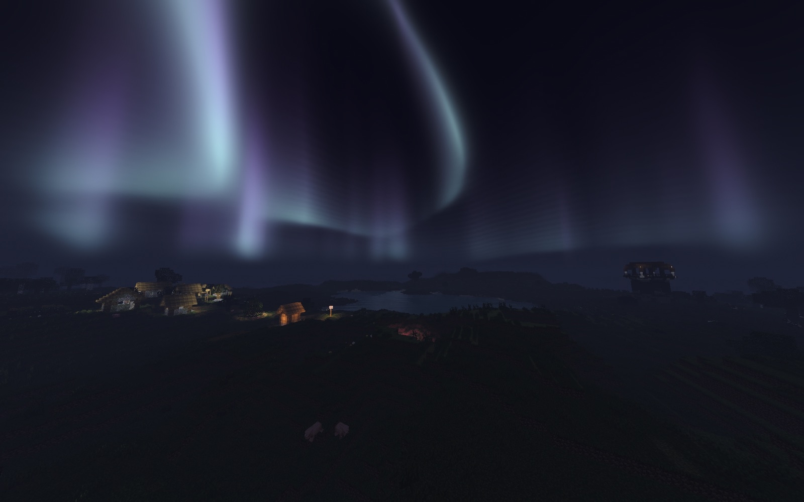</td>
    <td>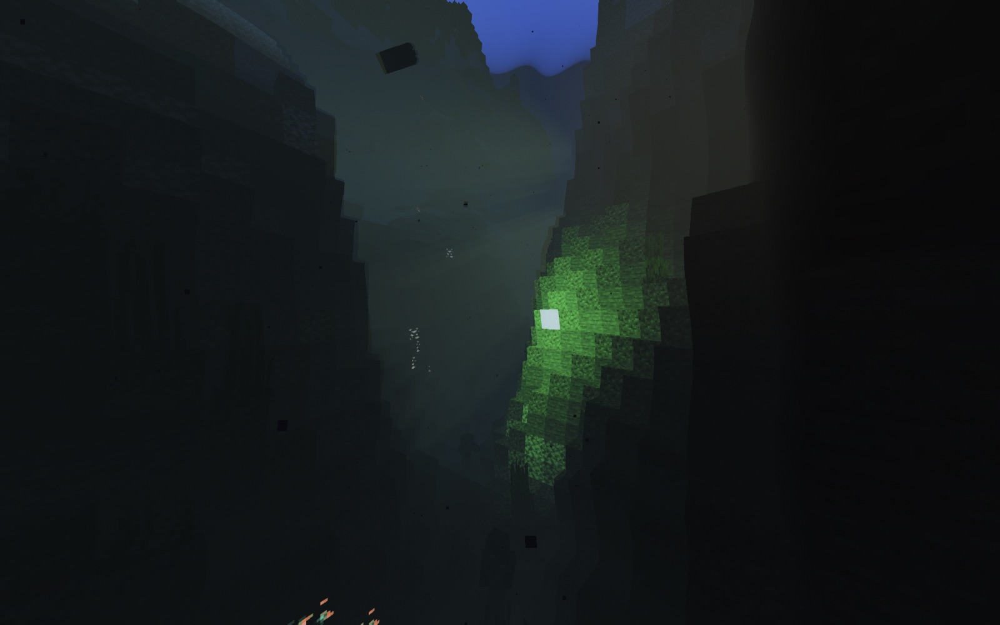</td>
  </tr>
  <tr>
    <td>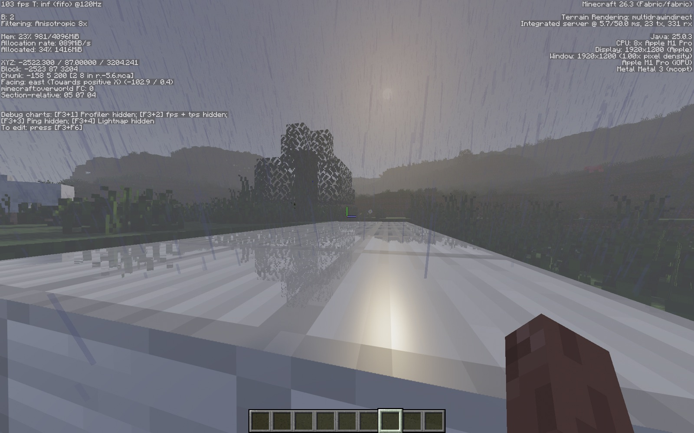</td>
    <td>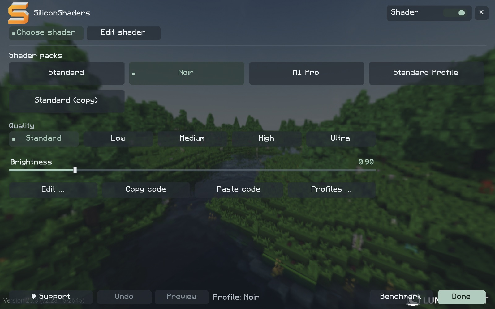</td>
  </tr>
  <tr>
    <td>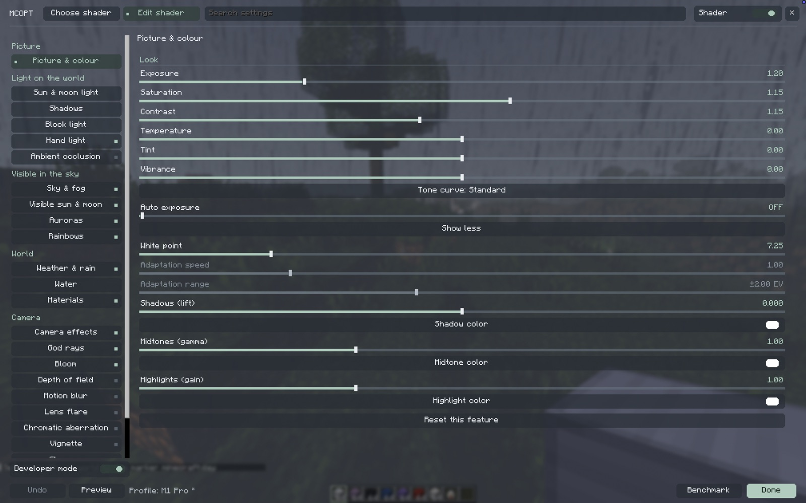</td>
    <td>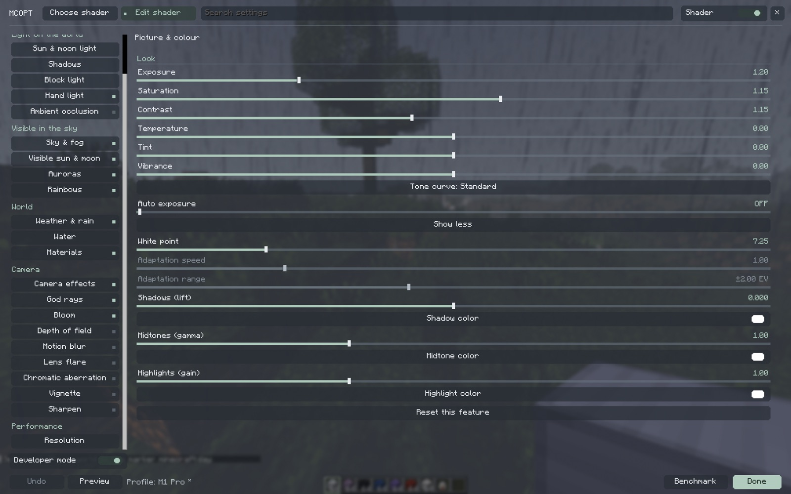</td>
  </tr>
</table>

### The End

<table>
  <tr>
    <td>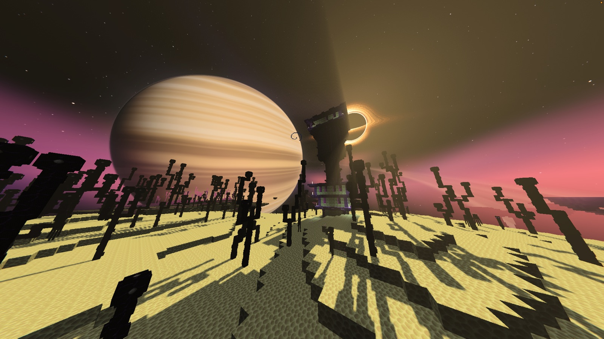</td>
    <td>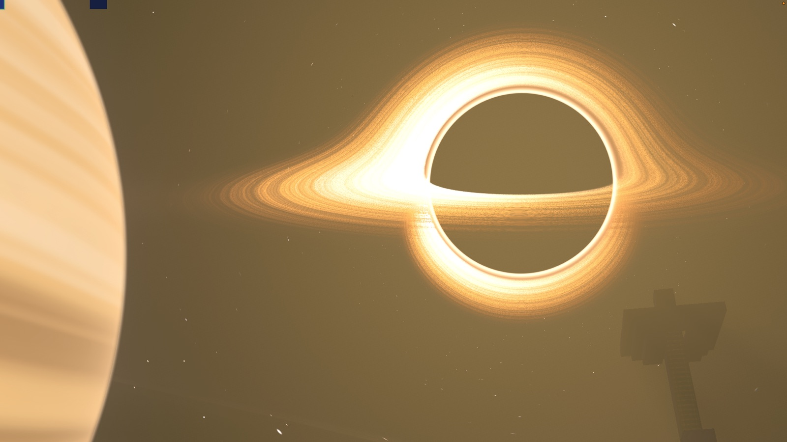</td>
  </tr>
  <tr>
    <td colspan="2">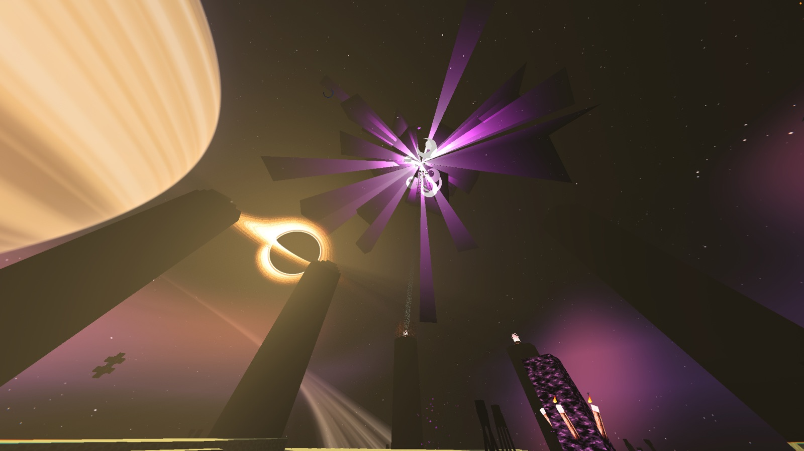</td>
  </tr>
</table>

## Requirements

- An Apple Silicon Mac (M1 or newer). Intel Macs, Windows and Linux are not supported.
- macOS 15 (Sequoia) or later
- Minecraft: Java Edition 26.3
- Fabric Loader 0.19.5 or newer
- Java 25 (an arm64 build, not an Intel Java running through Rosetta)

On an unsupported computer the game stops at launch with a message saying why.

## Installation

1. Install Fabric Loader for Minecraft 26.3: https://fabricmc.net/use/installer/
2. Put the SiliconShaders JAR in the instance's `mods` folder.
3. Start Minecraft with the Fabric profile. The settings are under Options → Video Settings.

**Not compatible with:** Sodium and Iris. Remove them; Fabric refuses to start with both installed.
If you used MCOpt before, replace its JAR. Do not keep both.

## Features

- **Light and shadows:** sun and moon light with shadows, coloured block light, light from items held in the hand,
  ambient occlusion
- **World:** animated water with reflections and refraction, underwater fog, rain with drops, wet surfaces and puddles,
  thunderstorm lighting, waving plants, materials with gloss, emission and metal
- **Sky:** sky and fog, auroras, a night nebula, rainbows, visible sun and moon
- **Nether and End:** their own lighting, haze and fog. The End has a procedural sky with stars, a black hole and a
  ringed planet.
- **Camera:** light rays, bloom, depth of field, motion blur, lens flares, chromatic aberration, vignette, sharpening
- **Performance:** MetalFX upscaling, quality settings tuned for each Apple Silicon generation, Smart Leaves
- **Profiles:** save your own profiles, and share them as a code that others can import
- A key to switch the shader on and off (set it under Controls → SiliconShaders)

The menu is available in English and German.

### Benchmark

The Benchmark button in the graphics menu runs a fixed test in a separate benchmark world. It compares the cost of
shadows, water, ambient occlusion, MetalFX, camera effects and weather on your Mac.
Results are saved in the `siliconshaders-benchmarks` folder in the game directory. Press Esc to cancel.

### Shader packs (experimental)

SiliconShaders can apply the final image pass of some shader packs in the Overworld. Pack lighting, shadows and water
are not supported yet, so a pack does not look the way it does with Iris.

### Developer settings

The Developer switch in the graphics menu shows implementation switches used for comparisons and debugging.
It is off each time the menu opens. You do not normally need it.

## Known issues

- Shadow edges can still jump slightly while the sun moves, most visibly at low shadow resolutions.
- Motion blur only follows the camera. Entities and particles do not blur on their own.
- Performance varies between Mac models. Not every model has been measured.

## Reporting bugs

Report bugs and crashes in the [issue tracker](https://github.com/rellefnediew/SiliconShaders/issues).
For a crash, upload the crash report (`crash-reports` folder) or `logs/latest.log` to https://mclo.gs and paste
the link into the report.

## Files

Settings are stored in `config/siliconshaders*`. Caches and benchmark results go into `siliconshaders-*` folders in
the game directory. SiliconShaders makes no network connections.

### Coming from MCOpt

On first start, old `config/mcopt*.json` settings, profile libraries and `mcopt.properties` are imported to
`config/siliconshaders*`. The original files stay where they are. Existing SiliconShaders settings take priority.
Old `-Dmcopt.*` JVM options are still accepted; explicit `-Dsiliconshaders.*` options take priority.
Old `MCOPT1:` profile codes can still be imported. New exports start with `SILICONSHADERS1:`.

## Building from source

Run `./gradlew :metal:build` with JDK 25 and Apple's Command Line Tools on an Apple Silicon Mac.
The installable JAR is written to `metal/build/libs/SiliconShaders-<version>.jar`, native library included.
`tools/release` builds the JAR and the release ZIP into `dist/`.

## Credits and license

SiliconShaders is developed by Kela. It is based on [mcopt](https://github.com/noahdunnagan/mcopt) by
[Noah Dunnagan](https://github.com/noahdunnagan), which is also licensed under Apache-2.0.

Licensed under the [Apache License 2.0](LICENSE). See [NOTICE](NOTICE) for attribution.
